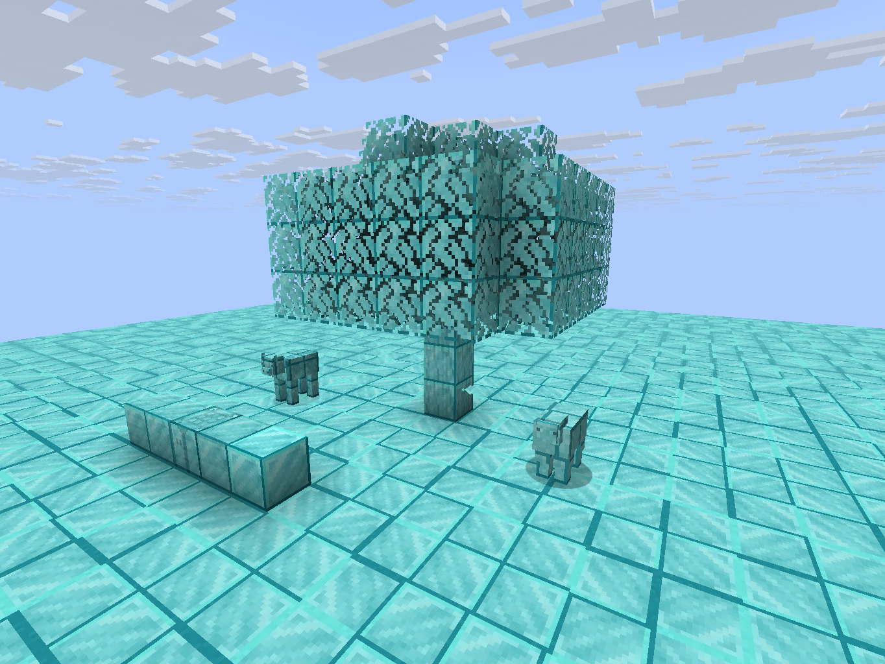
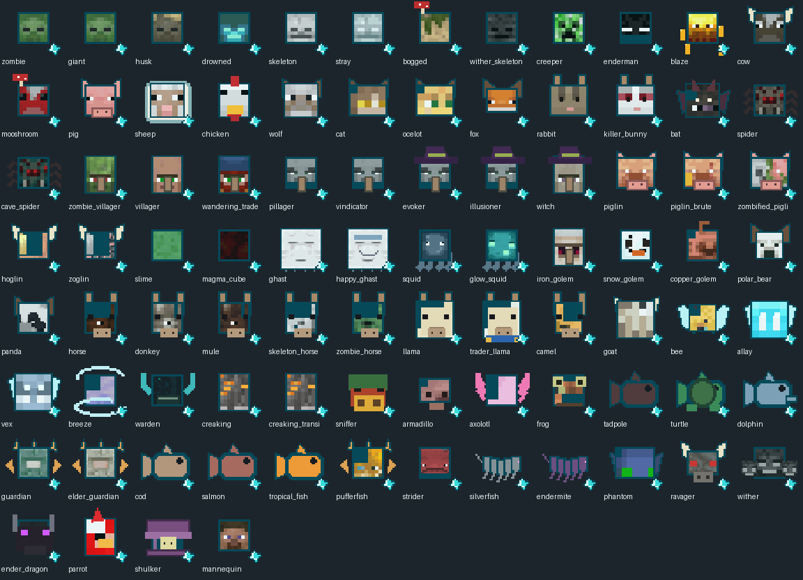

# 钻石世界 · Diamond World v1.1.0

Minecraft Java **1.21.10 / Fabric**。世界以钻石块的晶面、亮边和斜向高光为主，只保留少量木纹、石纹、炉口等识别细节。不是仅将原贴图染蓝。



## 下载与升级

- [下载 v1.1.0 MOD JAR](https://github.com/susu2020oxo/OreChests-Fabric-1.21.10/raw/refs/heads/diamondworld-1.21.10/downloads/DiamondWorld-Fabric-1.21.10-v1.1.0.jar)
- [下载 v1.1.0 ZIP 安装包（含 Fabric API）](https://github.com/susu2020oxo/OreChests-Fabric-1.21.10/raw/refs/heads/diamondworld-1.21.10/downloads/DiamondWorld-Fabric-1.21.10-v1.1.0.zip)

使用 **Java 21 + Minecraft Java 1.21.10 + Fabric Loader 0.17.3 或更高版本**。

将模组和 **Fabric API 0.138.4+1.21.10** 放入该实例的 `mods` 文件夹。ZIP 已包含两个 JAR。升级时删除旧版 DiamondWorld JAR，再放新版；不要同时加载两个版本。资源已内置，无须另装资源包。多人游戏时客户端与服务端都需安装。原来的钻石碎片、食物和精华物品 ID 保留。

## v1.1 精华与特殊能力

85 种真实生物的精华都改为对应的头像缩略图，附小钻石标记，创造栏和物品提示可查看。精华基础提供恢复，并按生物增加不同能力。



| 生物精华 | 主要特性 |
| --- | --- |
| 蝙蝠 | 飞行 15 秒、夜视 30 秒；双击跳跃开关飞行 |
| 鸡 | 缓降 40 秒 |
| 蜘蛛 / 洞穴蜘蛛 | 贴墙前进攀爬 35 秒；洞穴蜘蛛附近战毒刺 |
| 末影人 / 末影螨 | 闪现 30 秒；按下潜行沿视线寻找 8 格内安全落点，4 秒冷却 |
| 苦力怕 | 蓄爆 30 秒；按下潜行爆发，不破坏地形，4 秒冷却 |
| 史莱姆 / 岩浆怪 | 高跳；史莱姆有缓降，岩浆怪有防火和烈焰近战 |
| 烈焰人 / 恶魂 / 幻翼 / 恼鬼 | 不同组合的短时飞行、防火、夜视或隐身 |
| 潜影贝 | 短时漂浮，接续缓降并获得防御 |
| 旋风人 | 高跳、缓降和风爆效果 |
| 守卫者 / 远古守卫者 | 反伤、水下呼吸和潮涌能量 |
| 海豚 / 鱿鱼 / 发光鱿鱼 | 海豚疾游；鱿鱼隐身；发光鱿鱼夜视和回声探测 |
| 河豚 / 美西螈 / 海龟 | 毒刺与反伤 / 更强恢复 / 抗性，均有水下呼吸 |
| 凋灵 / 凋灵骷髅 | 凋零近战；凋灵可飞行，凋灵骷髅附力量和防火 |
| 末影龙 | 飞行 30 秒、力量 II 和抗性 II |
| 监守者 | 回声标记 24 格内敌怪、力量 II、抗性 II 和夜视 |
| 山羊 | 高跳和近战冲撞击退 |
| 羊驼 / 雪傀儡 | 按下潜行吐唾沫 / 投雪球，1 秒冷却 |
| 嗅探兽 | 40 秒嗅探；显示附近矿石坐标和晶光 |
| 嘎枝 | 潜行时获得抗性 IV 的扎根防御 |
| 猫 / 豹猫 / 狐狸 | 夜视、灵敏移动、缓降和猫科威慑 |
| 僵尸 / 骷髅等普通战斗生物 | 恢复与力量 |

[完整 85 种精华的效果、等级和时间](ABILITIES.md)。多个精华效果可以共存；同时拥有多个主动能力时，潜行按“吐息/投雪 → 闪现 → 蓄爆”顺序触发。

飞行到期或喝奶后撤回临时权限，附 10 秒缓降用于落地；原本的创造/旁观飞行保留。临时权限不会写成存档中的永久飞行。状态可用牛奶清除。

## 敌对生物的钻石化行为

友好生物不添加改变环境的行为；中立怪仅在对应的攻击或追击条件下触发。

| 敌怪与触发动作 | 钻石化结果 |
| --- | --- |
| 苦力怕爆炸 | 爆炸后的暴露坑底、坑壁转成钻石矿石，保持坑口开放 |
| 骷髅变种、幻术师射箭 | 飞行轨迹留下实体钻石矿石，每支箭最多 40 块；玩家箭不触发 |
| 掠夺者箭 / 溺尸三叉戟命中 | 命中地面生成小型矿簇 |
| 恶魂、凋灵、旋风人爆炸 | 爆点暴露地表或坑壁结矿 |
| 烈焰人火球 / 女巫药水 / 龙息火球 / 潜影贝子弹命中 | 对应大小的晶化地表、矿池或墙面矿簇 |
| 监守者音爆 | 沿实际攻击方向形成地面矿脉 |
| 蜘蛛追击 | 身后蛛网与脚下矿石 |
| 史莱姆、岩浆怪落地 | 小片地面结矿 |
| 愤怒末影人传送 | 传送起终点地面结矿 |
| 守卫者激光 | 光束下方浅层水底形成矿脉 |
| 蠹虫、末影螨钻掘 | 附近表层矿石 |
| 僵尸追击、劫掠兽冲锋、幻翼低空俯冲、嘎枝追猎 | 对应的矿石足迹或地表矿簇 |
| 卫道士、猪灵蛮兵、凋灵骷髅近战命中 | 矿石重击 |
| 疣猪兽、僵尸疣猪兽命中 | 短矿沟 |
| 恼鬼穿行攻击、唤魔者尖牙命中 | 墙面或脚下结矿 |

所有新增地形变化遵守 `mobGriefing`：`/gamerule mobGriefing false` 可关闭这些结矿行为。只将地形类方块替换为矿石（箭轨迹允许在空气中生成）；不覆盖箱子、基岩、传送门和木板等建筑材料。石头本身属于可替换地形。原版爆炸的破坏规则仍然生效。

## 保留 v1.0 生存规则

- 草方块正常破坏掉落 **1 个钻石碎片**，精准采集也一样；创造破坏不掉落。
- **3 个碎片无序合成 1 颗原版钻石**；获得碎片解锁配方。
- 石头仍按原版条件掉落圆石，木头掉对应木头；原有配方和采集等级保留。
- 工具强化：**耐久 ×2、挖掘速度 ×1.5、基础攻击伤害 +2、附魔能力 +5**，攻击速度不变。
- 牛、羊、猪、鸡、兔与鱼类掉对应钻石食物；原版非食物战利品与用途保留。
- 钻石生食提供恢复 I 约 5 秒，熟食恢复 II 约 8 秒，饱食度满时也可食用；钻石腐肉/蜘蛛眼没有原版负面效果。
- 支持对应的熔炉、烟熏炉、营火烹饪和火焰击杀熟食。
- 成年生物额外掉 **1–2 个对应精华**；末影龙、凋灵、监守者掉 12 个。幼体不额外掉精华，遵守 `doMobLoot`。

## 材质与源码

2,791 张原版贴图使用钻石块主材质，保留原版透明轮廓、UV 尺寸和动画布局；包括方块、物品、掉落物、生物、装备、画、粒子和部分环境。精华头像为了辨识保留生物原配色，并带钻石标记。高优先级资源包、联网玩家自定义皮肤和其他模组材质不在覆盖范围；不包含光影包。

Java 21 构建：`./gradlew build`，Windows 使用 `gradlew.bat build`。已包含生成资源，可以直接构建。重新生成需要 Pillow 和官方 1.21.10 客户端 JAR：

```sh
python -m pip install Pillow
python generate_assets.py /path/to/1.21.10.jar
```

主脚本自动调用 `generate_essence_icons.py` 生成对应头像。

可选临时测试世界：在 `run/eula.txt` 接受 Minecraft EULA 后执行 `./gradlew runServer -PverifyWorld`。运行真实掉落、配方、食用、飞行权限与存档、爆炸和箭轨迹集成检查后自动停止服务器。详见 [验证记录](VALIDATION.md)。正常运行不启用测试或预览场景。

自有代码采用 MIT。衍生材质的原始资源权利属于 Mojang / Microsoft，不适用代码许可证。项目不包含原版游戏 JAR、启动器或光影包。Fabric API 按其自身许可证提供。
